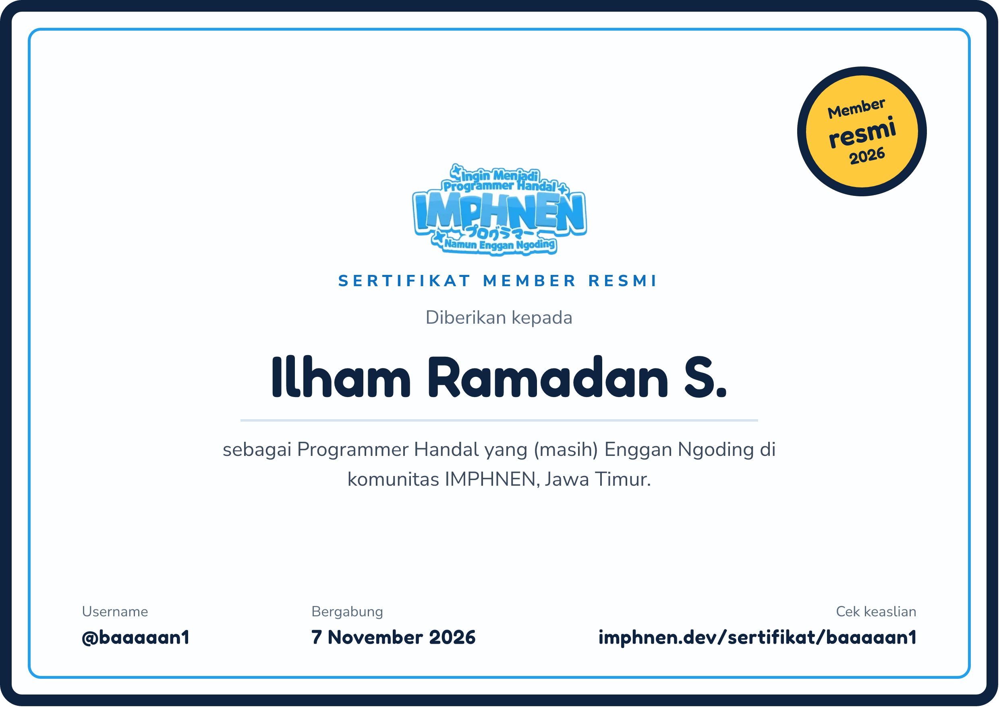

**Hi, I'm baaaaan1**

### Embedded Systems & Electronic Product Development

I turn circuit designs into working products, combining PCB development, embedded firmware, and control systems with desktop and web software.

  <a href="https://maps.google.com/?q=Blitar,Indonesia">Blitar, Indonesia</a>
  &nbsp;|&nbsp;
  <a href="https://github.com/ABToolkit">ABToolkit</a>

---

## Core Skills & Engineering Stack

### Embedded Firmware & Control

  
  
  
  
  

### Electronics, PCB & Prototyping

  
  

### Desktop, Web & Automation

  
  
  
  
  
  
  
  

### Product R&D & Workshop

  
  
  
  

---

## Selected Projects

<table>
  <tr>
    <td width="50%" valign="top">
      
<strong><code>T12_LowEnd_V2</code></strong>&nbsp; 

      
ATmega328P firmware for a T12 soldering station with precise thermal control, three temperature presets, standby modes, and runtime safety monitoring.

      
<code>ATmega328P</code> · <code>C++</code> · <code>PlatformIO</code> · <code>PID</code> · <code>I2C LCD</code>

    </td>
    <td width="50%" valign="top">
      
<strong><code>Blower-I2C-2026</code></strong>&nbsp; 

      
STM32 hot-air rework-station controller with adaptive PID, airflow management, distributed burst-fire control, presets, and automatic cooldown protection.

      
<code>STM32F103</code> · <code>C++</code> · <code>PID</code> · <code>I2C</code> · <code>EEPROM</code>

    </td>
  </tr>
  <tr>
    <td width="50%" valign="top">
      
<strong><code>Display-Universal</code></strong>&nbsp; 

      
Universal power monitor for voltage, current, power, and energy measurement with configurable OCP/OVP and automatic relay protection.

      
<code>ATmega328P</code> · <code>ADC</code> · <code>INA180</code> · <code>CRC16</code> · <code>LCD</code>

    </td>
    <td width="50%" valign="top">
      
<strong><code>T210_HIGHEND_V2</code></strong>&nbsp; 

      
STM32 T210 soldering-station firmware with heater-off ADC sampling, advanced PID control, Nextion HMI, presets, and EEPROM-backed configuration.

      
<code>STM32F103</code> · <code>C++</code> · <code>Nextion</code> · <code>PID</code> · <code>USB CDC</code>

    </td>
  </tr>
  <tr>
    <td width="50%" valign="top">
      
<a href="https://github.com/baaaaan1/EEPROMHandler"><strong>EEPROMHandler</strong></a>&nbsp; 

      
Arduino-compatible I2C library for AT24Cxx EEPROM chips, with typed read/write APIs, validation helpers, and explicit chip configuration.

      
<code>Arduino</code> · <code>C++</code> · <code>I2C</code> · <code>AT24Cxx</code>

    </td>
    <td width="50%" valign="top">
      
<a href="https://github.com/baaaaan1/BuzzerManager"><strong>BuzzerManager</strong></a>&nbsp; 

      
Non-blocking Arduino library for running flexible beep patterns and controlling multiple buzzers independently without interrupting the main loop.

      
<code>Arduino</code> · <code>C++</code> · <code>Non-blocking</code>

    </td>
  </tr>
  <tr>
    <td width="50%" valign="top">
      
<strong><code>SerMon</code></strong>&nbsp; 

      
Windows serial-port monitor with a focused desktop interface for inspecting, logging, and diagnosing communication with embedded devices.

      
<code>Python</code> · <code>PySide6</code> · <code>pyserial</code> · <code>Desktop UI</code>

    </td>
    <td width="50%" valign="top">
      
<a href="https://github.com/baaaaan1/Playgrounds"><strong>Playgrounds</strong></a>&nbsp; 

      
Windows desktop AI playground with OpenAI-compatible endpoints, SSE streaming, configurable connection profiles, model discovery, local conversation history, and API key storage in Windows Credential Manager.

      
<code>Python</code> · <code>PyQt6</code> · <code>SSE</code> · <code>PyInstaller</code> · <code>WiX Toolset</code>

    </td>
  </tr>
</table>

---

## Community Membership

  

  IMPHNEN member since November 7, 2026. Click the certificate to verify membership.

---

### Let's Build Something Useful

Available for freelance, contract, remote, and onsite work involving embedded systems, electronic products, and hardware–software integration.

  
  

### Support My Work

If my projects have been useful to you, you can support my work through <strong><a href="https://tako.id/Baaaaan1">tako.id</a></strong>, a platform for sending tips to creators. Your support helps fund hardware prototypes, components, testing, and future open-source projects.

  

Scan or click the QR code to support my work at <a href="https://tako.id/Baaaaan1">tako.id/Baaaaan1</a>.

